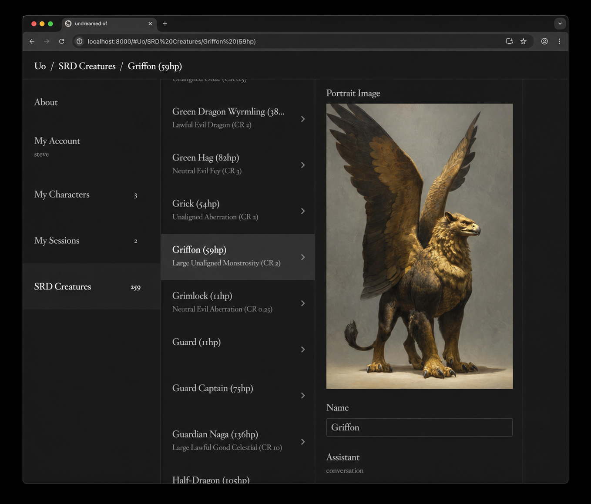

# Naked Objects

From Domain Models to Complete Applications

## Abstract

A [PDF of the earlier revision](compiled/Closing_the_Usability_Gap_in_Naked_Objects.pdf) is also available; it has not yet been updated to match this page.

The **Naked Objects** architectural pattern derives user interfaces from domain objects and their declared behavior. Strvct extends this approach with a compositional interaction grammar: recursive master-detail navigation, inline documents, and responsive anchored tabs. Developers declare domain state, behavior, and presentation intent; shared framework views implement the interaction mechanics.

The organizing idea is the **lens**: a screen exposes part of an object graph by choosing what is visible, whether children appear within their parent or in another pane, and how collections are arranged. This paper explains that design space, distinguishes implemented layouts from proposed extensions, and describes the metadata shared by UI, persistence, and agent interfaces.

A production application, **undreamedof.ai**, illustrates the approach across character management, campaigns, gameplay, and AI integration. Its reported inventory contains approximately 90 domain classes and two specialized custom views. These estimates illustrate broad reuse of framework views; they are not a measured percentage of generated screens or a comparative usability evaluation.

<a href="figures/GriffinScreenshot.png" target="_blank"></a>

*Production example: undreamedof.ai. The diagrams below isolate the navigation and layout mechanisms used to compose interfaces like this one.*


---

## 1. Introduction

Applications often repeat domain structure across model declarations, input controls, validation, persistence mappings, navigation, and integration schemas. A new property can require coordinated changes in several places. Shared components and schema-driven tools reduce this duplication, but application authors still commonly maintain a separate presentation structure.

**Naked Objects**, described by Pawson and Matthews [1], offers another approach: expose domain objects and actions through generated interfaces. Strvct retains that model-first architecture while exploring a richer set of reusable navigation and layout mechanisms.

```
                 ┌──► UI (Navigation, Fields, Documents & Tabs)
                 ├──► Storage (Local Pools & Cloud Sync)
Annotated Model ─┼──► Exchange (JSON Import, Export & Patches)
                 ├──► Agent Interface (Schema & Patch Operations)
                 └──► Headless Domain Execution
```

The contribution is a compositional account of those UI mechanisms and an implementation that reuses model metadata across subsystems. It does not remove domain design, presentation decisions, or the need to test the resulting experience.


---

## 2. The Usability Problem Addressed Here

Generating fields and collections is only part of generating a useful application. Users also need to retain context while traversing relationships, see related information together, and navigate on small screens. This paper focuses on three design requirements:

1. **Visible hierarchy:** Distinguish ownership, containment, and cross-references.
2. **Context-preserving navigation:** Keep the selected path legible as users move between related objects.
3. **Reusable responsive behavior:** Adapt the same navigation structure to different viewport sizes.

Forms and tables remain useful arrangements; the question is how they compose with other views. Existing model-driven systems also support customization: Apache Causeway, for example, documents UI extensions for maps and calendars [2]. Strvct's focus here is recursive composition of layered and inline views, rather than a claim that prior systems can render only forms and tables. Establishing comparative usability or explaining historical adoption would require separate evidence.


---

## 3. The Model as a Graph, the Screen as a Lens

Before describing the grammar itself, it helps to picture what a generated interface is actually showing.

Imagine the domain model as a graph: a tree of ownership, with symbolic links for the references that cross it. Now imagine drawing all of it at once—every object, every property, every collection, fully expanded. This drawing is the model's complete **UI projection**. This is a conceptual projection of the UI-exposed model, not a drawing that the runtime must materialize; internal or hidden properties need not be exposed.

Every screen the user sees is a **lens** over that drawing. At first order, a lens makes only two decisions:

1. **Visibility:** Which nodes to collapse. Typically everything off the current navigation path is collapsed, leaving the path itself and the immediate children of the nodes along it.
2. **Placement:** For each visible parent→child edge, whether the child is **layered** (given its own plane beside or in front of its parent, as in Miller columns, push stacks, and tabs) or **inlined** (drawn within its parent's extent, as in documents, grouped sections, and side-by-side panes).

<div style="width: 100%; max-width: 100vw; overflow: hidden;">
  <div style="padding: 0.2em 0 0.5em; margin: 0; text-align: center; font-weight: 600;">One Projection, Three Lenses</div>
  <object type="image/svg+xml" data="diagrams/svg/lens-placement.svg" style="display: block; margin: 0 auto; max-width: 600px; width: 90%;">[Lens Placement Diagram]</object>
</div>

Layering and inlining are not modes of the whole interface but choices made edge by edge, and they compose freely. A layered column may hold an inlined document whose link opens another layer; a document section may itself be a set of anchored tabs. The mixed lens above inlines *Project*'s sections in one column and layers *Task 2* into the next, and even the pure inlining lens layers its link to *Person*. Because the choice lives on each edge rather than on each screen, it can change without touching the model—set by a developer's hint, or switched by the framework as space changes.

At second order, a lens decides **arrangement**: how siblings within a layer or an inlined run are laid out—their orientation, whether their properties align across siblings into a table, or whether a value maps to position, as on a timeline (§4.1).

This framing reduces an apparently unbounded space of screens to something tractable. Within this grammar, a screen is described by a navigation path, placements for visible edges, and arrangements for visible collections. That is a small, regular decision space—small enough for the framework to own its mechanics (the path, collapse, layering, inlining, and responsive switching) while the developer states intent through hints on the model: which edges inline, which layer, how collections arrange. The decisions are the developer's; their implementation is the framework's.

It also explains behaviors that would otherwise have to be built screen by screen:
- **Navigation** is moving the lens. Traversing a relationship changes the path, not the model.
- **Responsive collapse** is the lens switching edges from inlined to layered as space runs out, within the bounds the hints allow. Miller columns that collapse into a push stack are still layered—in depth rather than side by side. Side-by-side panes that degrade to tabs are the same edge moving from inlined to layered.
- **Links** normally open another layer, making a cross-reference explicit. Recursive inlining also needs depth or cycle limits; layering alone does not bound the length of a navigation history.

None of these decisions is new to the literature. Furnas's fisheye views [8] formalize visibility as a degree-of-interest function over a tree; overview+detail and focus+context interfaces [9] separate or blend levels of detail much as layering and inlining do; and tree visualization distinguishes children drawn *within* their parents (inclusion) from children drawn *beside* them (adjacency) [10]. Inlining a linked target is what Nelson called transclusion [11]. Systems such as Furnas's, APT [12], and SUPPLE [5] go further and compute the presentation—by interest score, by search, or by optimization. Strvct deliberately does not. It owns the mechanism and supplies the defaults; the developer states intent through hints, much as a projectional editor lets a language designer declare the notation through which a model is edited [13].

Our use of *lens* differs from the Magic Lenses of HCI [14], which filter a local region of the screen. It shares the editable-view intuition of bidirectional programming [15], because edits flow back to the model; this analogy does not assert the formal round-trip laws of a bidirectional lens.

The UI projection is not the only one. The same graph is projected into records in object pools (the **storage projection**), into JSON for import, export, and patching (the **exchange projection**), and into a schema-and-patch tool interface for AI agents (the **agent projection**, §7.1). Each reads the same annotated model, while requiring its own framework implementation and application configuration.

---

## 4. A Narrow Design Space for Information Apps

The working hypothesis is that many structured-information interfaces can be expressed through relationship traversal, property editing, domain actions, and semantic collection arrangements. CRMs, project management tools, email clients, and settings panels provide useful examples. This is a design hypothesis about a substantial class of applications, not a proof that every task fits the grammar.

The framework can own interaction mechanics while developers choose which relationships and actions to expose and how to organize them. Task-specific workflows remain part of application design.

### 4.1 Relationship Traversal vs. Collection Arrangement

In terms of the lens (§3), we divide the user interface grammar into two distinct layers:

- **Relationship Traversal:** Moving the lens along links in the object graph (e.g., from a *Project* to its *Tasks*, then to a specific *Task*).
- **Collection Arrangement:** Displaying a set of related objects in a specific semantic layout (e.g., viewing *Tasks* as an ordered list, a Kanban board grouped by status, a table, or a timeline).

| Mechanism | Semantic Mapping | Examples | Implementation Scope |
| --- | --- | --- | --- |
| **Recursive Composition** | Parent-child relationships and presentation subtrees | Master-detail navigation, inline documents, anchored tabs | Implemented; arbitrary presets such as Kanban need their own grouping and interaction policies |
| **Cross-Sibling Alignment** | Equivalent property slots aligned across items | Tables, spreadsheets, pivot matrices | Proposed framework extension |
| **Value-to-Space Mapping** | Temporal or spatial values mapped to position and extent | Timelines, Gantt charts, calendars, maps | Part of the design space; no general generated arrangement established here |
| **Quantitative Encoding** | Numeric values mapped to marks or axes | Line charts, bar plots, heatmaps | Part of the design space; specialized renderers required unless supplied by the framework |

### 4.2 The Boundary of Automatic Generation

Generation covers the arrangements and controls the framework implements. A developer selects those mechanisms through metadata or node methods. A new arrangement or specialized interaction may require a new renderer; once implemented generically, that renderer can potentially serve multiple domain models.

Spatial meaning alone does not determine this boundary: both calendars and battle maps encode meaningful positions. The practical distinction is whether an existing renderer supports the required semantics and interactions. Creative canvases, code editors, 3D viewports, medical imaging, and specialized scientific plots often require additional rendering and interaction code.

An application can combine generated navigation, properties, and actions with such specialized surfaces. The amount of custom work depends on its tasks, not just its domain category.


---

## 5. Architecture & UI Mechanics in Strvct

Strvct implements this two-part grammar using client-side JavaScript. Master-detail views are its layering lens (§5.2); inline layouts are its inlining lens (§5.3). The core visual building blocks are **Tiles**, **Tile Stacks**, and **Master-Detail Views**.

### 5.1 Tiles and Tile Stacks

The fundamental primitive in Strvct is the **Tile**:

- **Summary Tile:** Displays a domain object with a title, subtitle, icon, and contextual actions. Selecting a summary tile opens its details in an adjacent column.

<div style="width: 100%; max-width: 100vw; overflow: hidden;">
  <div style="padding: 0.2em 0 0.5em; margin: 0; text-align: center; font-weight: 600;">Summary Tile</div>
  <object type="image/svg+xml" data="diagrams/svg/summary-tile.svg" style="display: block; margin: 0 auto; max-width: 400px; width: 80%;">[Summary Tile Diagram]</object>
</div>

- **Property Tile:** Displays an individual object property (key-value pair) with direct inline editing (text inputs, numbers, toggles, date pickers) and validation feedback.

<div style="width: 100%; max-width: 100vw; overflow: hidden;">
  <div style="padding: 0.2em 0 0.5em; margin: 0; text-align: center; font-weight: 600;">Property Tile</div>
  <object type="image/svg+xml" data="diagrams/svg/property-tile.svg" style="display: block; margin: 0 auto; max-width: 400px; width: 80%;">[Property Tile Diagram]</object>
</div>

A **Tile Stack** is a scrollable, ordered list or grid of tiles. Stacks support drag-and-drop reordering, slide-to-delete, and direct data import/export.

<div style="width: 100%; max-width: 100vw; overflow: hidden;">
  <div style="padding: 0.2em 0 0.5em; margin: 0; text-align: center; font-weight: 600;">Tile Stack</div>
  <object type="image/svg+xml" data="diagrams/svg/tiles.svg" style="display: block; margin: 0 auto; max-width: 200px; width: 60%;">[Tile Stack Diagram]</object>
</div>

### 5.2 Recursive Master-Detail Navigation

A **Master-Detail View** pairs a master tile stack with a detail pane showing the selected object's contents. Each selection layers the chosen child in a new pane. Because detail panes can themselves contain child master-detail views, navigation composes recursively to arbitrary depth.

<div style="width: 100%; max-width: 100vw; overflow: hidden;">
  <div style="padding: 0.2em 0 0.5em; margin: 0; text-align: center; font-weight: 600;">Master-Detail View</div>
  <object type="image/svg+xml" data="diagrams/svg/master-detail.svg" style="display: block; margin: 0 auto; max-width: 400px; width: 80%;">[Master-Detail Diagram]</object>
</div>

Key characteristics of Strvct's master-detail engine:
- **Flexible Orientation:** Each level can layout horizontally (like macOS Miller column file browsers) or vertically (like nested accordion lists or settings panels).

<div style="width: 100%; max-width: 100vw; overflow: hidden;">
  <div style="padding: 0.2em 0 0.5em; margin: 0; text-align: center; font-weight: 600;">Flexible Master-Detail Orientations</div>
  <object type="image/svg+xml" data="diagrams/svg/orientations.svg" style="display: block; margin: 0 auto; max-width: 500px; width: 90%;">[Orientations Diagram]</object>
</div>

- **Automatic Mobile Collapse:** When viewport space is constrained, earlier columns automatically collapse into a mobile push/pop stack equipped with interactive breadcrumbs—the same layers, stacked in depth rather than side by side. The shared navigation engine handles this collapse; application-specific content still needs responsive verification.

<div style="max-width: 600px; margin: 0 auto;">
  <div style="padding: 0.2em 0 0.5em; margin: 0; text-align: center; font-weight: 600;">Expanded Viewport (Desktop)</div>
  <object type="image/svg+xml" data="diagrams/svg/expanded.svg" style="display: block; width: 100%; height: auto;">[Expanded Viewport Diagram]</object>
</div>
<br>
<div style="max-width: 600px; margin: 0 auto;">
  <div style="padding: 0.2em 0 0.5em; margin: 0; text-align: center; font-weight: 600;">Collapsed Viewport (Mobile with Breadcrumbs)</div>
  <object type="image/svg+xml" data="diagrams/svg/collapsed.svg" style="display: block; width: 100%; height: auto;">[Collapsed Viewport Diagram]</object>
</div>

- **Compositional Diversity:** Combining vertical, horizontal, and hybrid orientations expresses Miller column browsers, email clients, settings panels, chat rooms, and inspectors within a single uniform primitive.

<div style="display: flex; flex-wrap: wrap; justify-content: center; gap: 2%; width: 100%;">
  <div style="min-width: 150px; width: 30%; text-align: center;">
    <div style="padding: 0.2em 0 0.5em; margin: 0; font-weight: 600;">Vertical</div>
    <object type="image/svg+xml" data="diagrams/svg/vertical-hierarchical-miller-columns.svg" style="width: 100%; height: auto;">[Vertical Diagram]</object>
  </div>
  <div style="min-width: 150px; width: 30%; text-align: center;">
    <div style="padding: 0.2em 0 0.5em; margin: 0; font-weight: 600;">Horizontal</div>
    <object type="image/svg+xml" data="diagrams/svg/horizontal-hierarchical-miller-columns.svg" style="width: 100%; height: auto;">[Horizontal Diagram]</object>
  </div>
  <div style="min-width: 150px; width: 30%; text-align: center;">
    <div style="padding: 0.2em 0 0.5em; margin: 0; font-weight: 600;">Hybrid</div>
    <object type="image/svg+xml" data="diagrams/svg/hybrid-hierarchical-miller-columns.svg" style="width: 100%; height: auto;">[Hybrid Diagram]</object>
  </div>
</div>

### 5.3 Advanced Inline Layouts

While column traversal is the default, certain complex screens require rendering child views directly inside parent tiles rather than pushing new columns. These children are inlined rather than layered. Strvct provides two inline layout mechanisms and a presentation-delegation hook:

<div style="width: 100%; max-width: 100vw; overflow: hidden;">
  <div style="padding: 0.2em 0 0.5em; margin: 0; text-align: center; font-weight: 600;">Comparison of Subtree Layouts</div>
  <object type="image/svg+xml" data="diagrams/svg/layouts-compared.svg" style="display: block; margin: 0 auto; max-width: 600px; width: 90%;">[Layouts Compared Diagram]</object>
</div>

1. **Anchored Tabs:** Renders selected children as interactive side-by-side panes or tab bars. Width arbitration automatically fits as many panes as space permits on wide desktop monitors while gracefully degrading to standard tabs on mobile.

<div style="max-width: 600px; margin: 0 auto;">
  <div style="padding: 0.2em 0 0.5em; margin: 0; text-align: center; font-weight: 600;">Anchored Tabs (Wide Screen)</div>
  <object type="image/svg+xml" data="diagrams/svg/anchored-tabs-wide.svg" style="display: block; width: 100%; height: auto;">[Anchored Tabs Wide Diagram]</object>
</div>
<br>
<div style="max-width: 240px; margin: 0 auto;">
  <div style="padding: 0.2em 0 0.5em; margin: 0; text-align: center; font-weight: 600;">Anchored Tabs (Narrow Screen)</div>
  <object type="image/svg+xml" data="diagrams/svg/anchored-tabs-narrow.svg" style="display: block; width: 100%; height: auto;">[Anchored Tabs Narrow Diagram]</object>
</div>

2. **Document Inlining:** Renders a nested subtree as a continuous multi-column document with flowing sections, headers, and fields. Fields edit in place without triggering navigation transitions.

<div style="width: 100%; max-width: 100vw; overflow: hidden;">
  <div style="padding: 0.2em 0 0.5em; margin: 0; text-align: center; font-weight: 600;">Inline Document Flow</div>
  <object type="image/svg+xml" data="diagrams/svg/inline-document.svg" style="display: block; margin: 0 auto; max-width: 600px; width: 90%;">[Inline Document Diagram]</object>
</div>

3. **Presented Nodes (Presentation Delegation):** Allows an object to delegate its presentation to a derived node (e.g., displaying a structured RPG character sheet instead of raw property slots), providing bespoke reading views without custom component templates.

<div style="width: 100%; max-width: 100vw; overflow: hidden;">
  <div style="padding: 0.2em 0 0.5em; margin: 0; text-align: center; font-weight: 600;">Presented Node Pattern</div>
  <object type="image/svg+xml" data="diagrams/svg/presented-node.svg" style="display: block; margin: 0 auto; max-width: 600px; width: 90%;">[Presented Node Diagram]</object>
</div>

---

## 6. Model Declarations & The Annotation Bridge

Developers define domain models as JavaScript classes inheriting from `SvStorableNode`. Properties are declared as **slots** enriched with metadata annotations:

```javascript
(class Character extends SvStorableNode {

    initPrototypeSlots () {
        // Name slot: String property, persisted, synced to view, editable
        {
            const slot = this.newSlot("name", "");
            slot.setSlotType("String");
            slot.setShouldStoreSlot(true);
            slot.setSyncsToView(true);
            slot.setCanInspect(true);
            slot.setIsSubnodeField(true);
            slot.setCanEditInspection(true);
        }
        // Level slot: Number property
        {
            const slot = this.newSlot("level", 1);
            slot.setSlotType("Number");
            slot.setShouldStoreSlot(true);
            slot.setSyncsToView(true);
            slot.setCanInspect(true);
            slot.setIsSubnodeField(true);
        }
        // Inventory relationship: Navigable child object
        {
            const slot = this.newSlot("inventory", null);
            slot.setSlotType("Inventory");
            slot.setShouldStoreSlot(true);
            slot.setFinalInitProto(Inventory);
            slot.setIsSubnodeField(true);
        }
    }

    initPrototype () {
        this.setShouldStore(true);
    }

    title () {
        return this.name() || "Unnamed Character";
    }

    subtitle () {
        return "Level " + this.level();
    }

}.initThisClass());
```

### 6.1 Worked Example: From a Model to a Lens

The `Character` declaration assumes an application-defined `Inventory` node class. `isSubnodeField` exposes each property as a field in the node's contents; `canInspect` also exposes it in the developer inspector. Neither persistence nor view synchronization alone makes a property visible.

With the default `nodeChildrenLayout()` value of `"column"`, selecting a character opens its fields and Inventory relationship in the next pane. Selecting Inventory traverses that relationship. On a narrow viewport, earlier navigation panes collapse and breadcrumbs retain access to the path.

To show the same contents as a document, the class can override an existing presentation hook:

```javascript
// Methods inside Character; the stored properties remain the same.
nodeChildrenLayout () {
    return "inline";
}

nodeInlineDepth () {
    return 1;
}
```

If Inventory is large and should remain a navigable summary within that document, its class can override `nodeIsInlined()` to return `false`. A container that should show its children as responsive anchored tabs instead overrides `nodeSubnodesAreAnchoredTabs()` to return `true`. These are node-level policies interpreted by shared views, rather than separately authored screens.

Adding a `species` slot with the same type, visibility, persistence, and synchronization annotations as `name` makes it available to the shared field renderer and storage serializer. Labels, constraints, and presentation order still need deliberate choices. This illustrates the maintenance benefit: reuse of the field machinery rather than the elimination of presentation design.

### 6.2 Actions and Workflows

Domain behavior must also be exposed deliberately. An action slot names a model method, and an optional `<methodName>ActionInfo()` method supplies presentation state. For example, these members can be added to `Character`:

```javascript
// Inside initPrototypeSlots():
{
    const slot = this.newSlot("advanceLevelAction", null);
    slot.setSlotType("Action");
    slot.setIsSubnodeField(true);
    slot.setActionMethodName("advanceLevel");
}

// Methods on Character:
advanceLevel () {
    if (this.level() >= 20) {
        throw new Error("Character is already at the maximum level");
    }
    this.setLevel(this.level() + 1);
}

advanceLevelActionInfo () {
    return {
        title: "Advance Level",
        isEnabled: this.level() < 20,
        isVisible: true
    };
}
```

The shared action field reads availability from the model and invokes the method; domain checks remain necessary for callers outside the UI. Slot constraints support field validation, while cross-property rules and failed operations need useful application feedback. Bulk operations and multi-step workflows require explicit domain methods and state; they do not follow automatically from navigation relationships.

### 6.3 The Multi-Reader Annotation Architecture

Slot annotations serve as a decoupling bridge. Each framework subsystem reads slot metadata independently without cross-system dependencies:

- **UI Layer (UI Projection):** Reads `slotType`, `canEditInspection`, and `isSubnodeField` to instantiate Property Tiles and navigate child subnodes.
- **Persistence Layer (Storage Projection):** Reads `shouldStoreSlot` to serialize records into local storage (IndexedDB) and cloud object pools.
- **Sync Scheduler:** Reads `syncsToView` to observe slot updates and post coalesced, deferred notifications to active views.
- **Agent Projection:** Reads property types and constraints to auto-generate JSON validation schemas and patch tools.
- **Localization Engine:** Reads property names and translation contexts to auto-translate labels.

```
                  ┌──► UI Rendering Layer (Property Tiles & Controls)
                  ├──► Persistence Engine (IndexedDB & Cloud Commit)
Slot Metadata ────┼──► Sync Scheduler (Weak Observer Notifications)
                  ├──► AI Agent Infrastructure (Patch Schemas & Verification)
                  └──► Internationalization Engine (Label Translation)
```

---

## 7. Shared Architectural Capabilities

Shared metadata lets framework subsystems reuse declarations. These capabilities require framework implementation, application configuration, and testing; their benefit is that much of that work is shared across generated views:

### 7.1 Natively AI-Operable Model
The agent projection uses slot metadata for a schema-and-patch interface, described here by two generic operation types:
1. `schema-fetch`: Retrieves the slot schema for any domain class or object instance.
2. `apply-patch`: Applies a JSON patch payload to update properties or mutate child relationships.

The number of operation types can remain constant as classes are added; schema volume, discovery work, and agent context do not. Invalid patches can return schema information for a correction attempt. A usable deployment must also define the exposed root objects, traversal and access rules, and how domain actions are invoked. A small tool vocabulary alone does not establish task success or low reasoning cost.

### 7.2 Headless Domain Execution and Testing
Domain classes that keep browser dependencies in the view and service layers can run under Node.js. Tests can instantiate model graphs, invoke methods, and assert slot states without browser automation. This makes domain testing cheaper; layout, focus, gestures, and browser integration still require UI tests.

### 7.3 Transparent Persistence and Cloud Sync
Strvct divides persistence into two unified strategies:
- **Local Object Pools:** In-memory access to loaded domain objects, with asynchronous IndexedDB persistence.
- **Content-Addressable Blob Store:** Asynchronous SHA-256 keyed storage for large binary assets (images, audio, files).

Cloud synchronization sends versioned atomic commits containing only the modified slot records. Conflicts are detected deterministically per document pool.

### 7.4 Shared Accessibility and Localization
Accessibility and localization are properties of the UI projection rather than projections of their own, and both are handled at the framework primitive level: translation is applied at the model-to-view boundary, as labels leave the model. Shared view primitives centralize ARIA roles, focus management, keyboard navigation, and translation hooks. Fixes in a primitive can benefit every view that uses it. Application-specific labels, reading order, custom renderers, assistive-technology behavior, and translation quality still need validation.

### 7.5 Live Inspector & Developer Mode
Every tile supports modifier-clicking (Option + Click) to reveal a live Property Inspector displaying all declared slots, storage flags, and validation states. Developers can toggle Developer Mode to inspect hidden internal subnodes without writing custom debugging views.


---

## 8. Empirical Case Study: undreamedof.ai

Strvct was used to build **undreamedof.ai**, a commercial AI-powered virtual tabletop application for tabletop roleplaying games (D&D 5e). 

### Reported Application Inventory

| Subsystem | Estimated Domain Classes | Reported Specialized Custom Views |
| --- | ---: | --- |
| **Character System** | ~30 | None reported |
| **Campaign Hierarchy** | ~20 | Map viewer |
| **Session & Gameplay** | ~25 | 3D dice engine |
| **AI Integration & Tools** | ~15 | None reported |
| **Total** | **~90** | **2** |

The application uses framework views for character sheets, inventory managers, spellbooks, campaign trees, settings, chat logs, and inspectors. Its reported specialized surfaces are a 3D WebGL dice roller and an interactive tactical battle map.

**Measurement limits:** These are author-reported estimates retained from the case-study description, not a dated source audit. The inventory does not count screens, runtime view instances, presentation-node code, or customization effort. Dividing two custom view classes by approximately 90 domain classes would mix units, so this paper does not report that ratio as a generated-screen percentage.

The case study demonstrates use across several subsystems and is consistent with the proposed reuse boundary. It does not establish that all non-graphical tasks fit the grammar or that users perform better than with another interface. A reproducible follow-up should identify a source revision, classify application-specific presentation code, define the counting unit, and compare representative tasks on completion rate, time, navigation errors, and mobile usability.


---

## 9. Comparison with Related Paradigms

| Dimension | Component Frameworks | Low-Code / Visual Builders | Strvct |
| --- | --- | --- | --- |
| **Primary Presentation Artifact** | Components and application composition | Visual layouts and bindings | Annotated nodes and presentation policies |
| **Reuse Mechanism** | Shared components, libraries, schema-driven tools | Platform widgets, templates, connectors | Shared views interpreting node and slot metadata |
| **Presentation Decisions** | Usually expressed in components | Usually expressed in visual configuration | Expressed in model metadata, node methods, and presentation nodes |
| **Maintenance Tradeoff** | App authors maintain composition and integration | App authors maintain layouts and platform configuration | Shared mechanics reduce repeated view code; metadata and domain complexity still grow |
| **Agent Integration** | Application- or library-defined APIs and tools | Platform- or application-defined connectors | Schema-and-patch operations derived from exposed metadata |
| **Persistence** | Chosen and integrated by the application | Platform-dependent | Framework object pools and cloud synchronization |

These categories overlap: component applications can derive forms from schemas, and low-code platforms can infer interfaces from data. Strvct's distinguishing commitment is to use the annotated object graph as the primary source for navigation, editing, and several non-UI subsystems. This table describes architectural defaults, not measured productivity differences.


---

## 10. Limitations & Future Work

Several limitations and questions remain:

1. **Renderer Coverage:** Canvas editing, CAD, video sequencing, and 3D gaming typically need specialized renderers and interaction policies. The generation boundary depends on the controls and arrangements available in the framework (§4.2).
2. **Ecosystem Isolation:** To support content-addressable bundling and zero-build client loading, Strvct uses a custom resource loader rather than standard npm/Webpack/Vite tooling.
3. **Aligned Grid Arrangements (Tables & Spreadsheets):** While inline document flow and anchored tabs are production-proven, cross-sibling column alignment (making row tiles align into full spreadsheets) is currently a proposed framework extension.
4. **Extreme Collection Scaling:** Lazy view instantiation keeps rendering lightweight, but virtualized viewport scrolling for mega-collections (100,000 or more items) remains an active area of optimization.
5. **Evaluation and Workflows:** Comparative usability, accessibility, development effort, and complex workflow coverage have not been quantified here. A production deployment is evidence of feasibility, not a controlled evaluation.
6. **User-Chosen Lenses:** Because placement and arrangement are per-edge hints rather than authored screens, users could in principle reshape their own lenses—inlining a section they always want open, or layering one they rarely need. This is possible today through the live inspectors (§7.5), but not every hint is persisted; a supported, persistent user-facing control is future work. Engelbart's NLS gave users *viewspecs*—how many levels to show, how many lines per item—for much the same purpose [16].

---

## 11. Conclusion

Strvct demonstrates a model-first approach in which shared views interpret an annotated object graph. Its implemented navigation grammar combines recursive master-detail panes, inline documents, responsive anchored tabs, and presentation delegation. The lens model explains how these mechanisms can compose without a separately authored component tree for every screen.

The production case study illustrates reuse across a substantial application, while leaving quantitative coverage, development cost, and comparative usability open for evaluation. Tables with cross-sibling alignment and other semantic arrangements remain extensions rather than established capabilities of this implementation.

The practical promise is reduced duplication: developers maintain domain behavior and presentation intent, while the framework shares the machinery for rendering, synchronization, storage, and agent access.

### Continue with the Framework

- [Getting Started](../Getting%20Started/index.html): set up and run an application.
- [Slots](../Slots/index.html): declare types, storage flags, visibility, and editing metadata.
- [Views](../Views/index.html): understand shared views and customization.
- [Nodes](../Nodes/index.html): work with the domain object hierarchy.


---

## References

[1] Pawson, R., & Matthews, R. (2002). *Naked Objects.* Wiley.

[2] Apache Software Foundation. [*Apache Causeway*](https://causeway.apache.org/) (formerly Apache Isis), including its description of UI extensions. Accessed October 28, 2026.

[3] Miller Columns. *Wikipedia.* https://en.wikipedia.org/wiki/Miller_columns (NeXTSTEP navigation pattern).

[4] Brambilla, M., & Fraternali, P. (2014). Interaction Flow Modeling Language. *WWW '14.*

[5] Gajos, K., & Weld, D. S. (2004). SUPPLE: Automatically Generating User Interfaces. *IUI '04.*

[6] Jackson, D. (2021). *The Essence of Software: Why Concepts Matter for Great Design.* Princeton University Press.

[7] Meng, E., & Jackson, D. (2025). What You See Is What It Does: A Structural Pattern for Legible Software. *Onward! 2025.*

[8] Furnas, G. W. (1986). Generalized Fisheye Views. *CHI '86*, 16–23.

[9] Cockburn, A., Karlson, A., & Bederson, B. B. (2008). A Review of Overview+Detail, Zooming, and Focus+Context Interfaces. *ACM Computing Surveys*, 41(1).

[10] Schulz, H.-J., Hadlak, S., & Schumann, H. (2011). The Design Space of Implicit Hierarchy Visualization: A Survey. *IEEE Transactions on Visualization and Computer Graphics*, 17(4), 393–411.

[11] Nelson, T. H. (1981). *Literary Machines.* Mindful Press.

[12] Mackinlay, J. (1986). Automating the Design of Graphical Presentations of Relational Information. *ACM Transactions on Graphics*, 5(2), 110–141.

[13] Voelter, M., Siegmund, J., Berger, T., & Kolb, B. (2014). Towards User-Friendly Projectional Editors. *SLE 2014*, 41–61.

[14] Bier, E. A., Stone, M. C., Pier, K., Buxton, W., & DeRose, T. D. (1993). Toolglass and Magic Lenses: The See-Through Interface. *SIGGRAPH '93.*

[15] Foster, J. N., Greenwald, M. B., Moore, J. T., Pierce, B. C., & Schmitt, A. (2007). Combinators for Bidirectional Tree Transformations: A Linguistic Approach to the View-Update Problem. *ACM Transactions on Programming Languages and Systems*, 29(3).

[16] Engelbart, D. C., & English, W. K. (1968). A Research Center for Augmenting Human Intellect. *AFIPS Fall Joint Computer Conference.*
